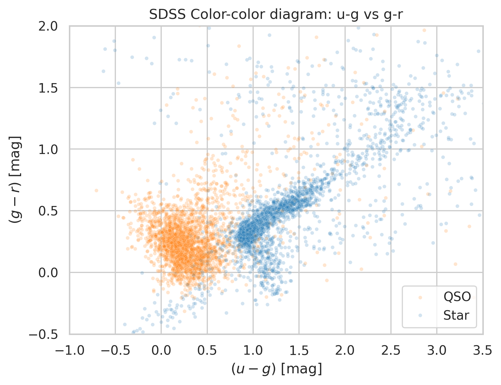
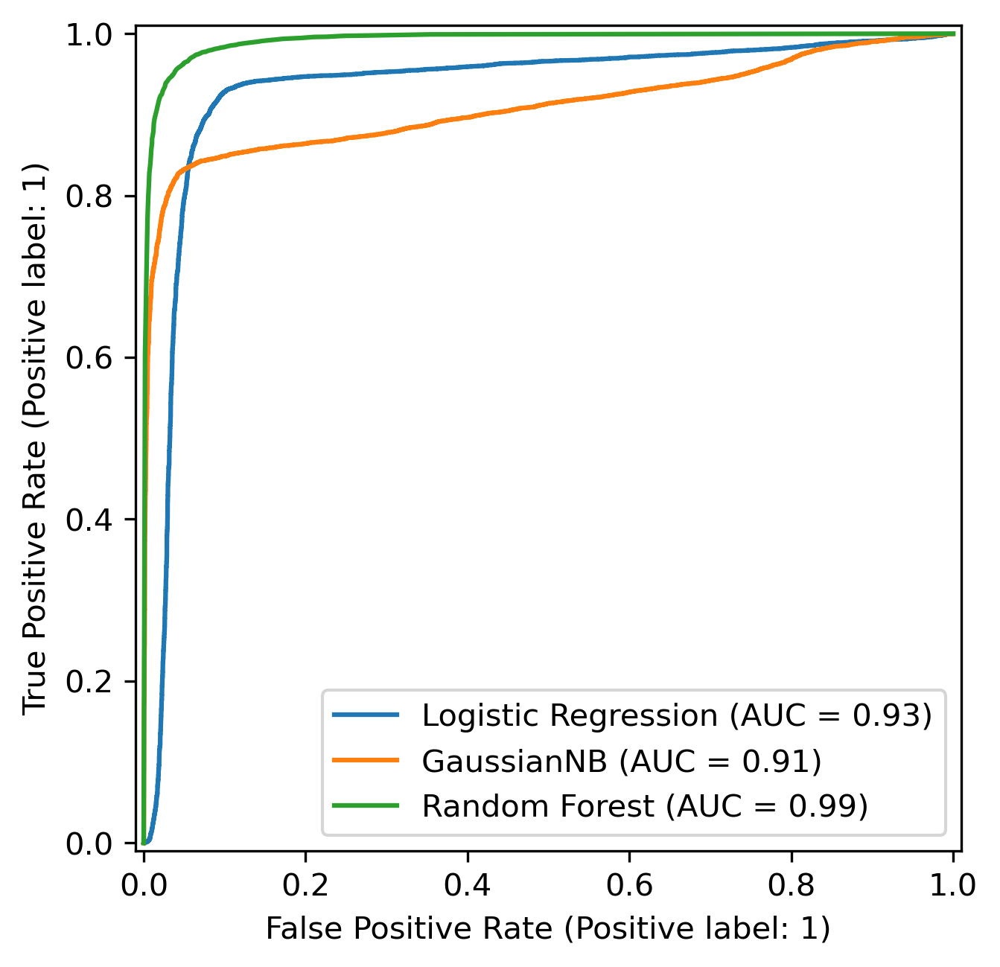
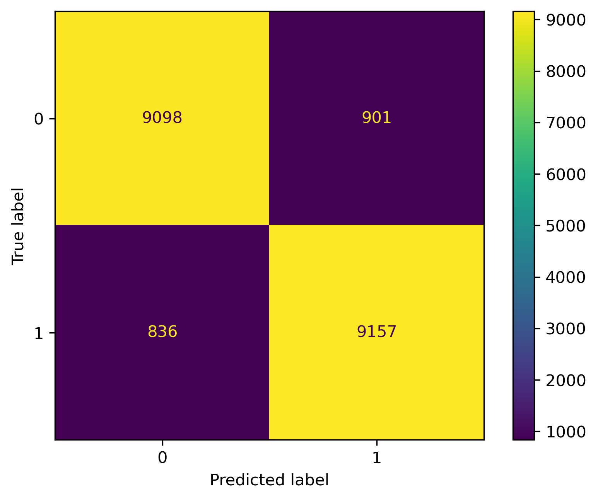

# SDSS Quasar Classifier

[](#-project-status--roadmap)
[](https://www.python.org/)

A machine learning project designed to classify astronomical objects (**Quasars** vs. **Stars**) using real photometric observations from the **Sloan Digital Sky Survey (SDSS DR16)**.

---

## Context

Differentiating common stars from quasars (distant, supermassive active galactic nuclei) is a foundational challenge in observational astrophysics. Due to the cosmological expansion of the universe, light emitted by quasars undergoes redshift ($z$), shifting key emission lines and spectral continuum slopes across photometric passbands. 

This pipeline uses classification algorithms to learn these distinct spectral distributions across the SDSS 5-band photometric filter system:
* **`u`**: Ultraviolet
* **`g`**: Green
* **`r`**: Red
* **`i`**: Near-Infrared
* **`z`**: Far-Infrared

### Feature Engineering
To capture spectral slopes independently of total apparent brightness or distance, the pipeline computes adjacent **astronomical color indices**:
$$\Delta \text{color} \in \{ (u - g), (g - r), (r - i), (i - z) \}$$
These color differentials help separate quasar redshift tracks from the stellar locus in multi-dimensional color space.

<p align="center">
  
</p>


---

## Project Structure

```text
sdss-quasar-classification/
├── data/
│   ├── raw/                            # Raw extracted SDSS DR16 data (sdss_raw.csv)
│   └── processed/                      # Cleaned datasets and engineered feature matrices
├── models/                             # Serialized Scikit-Learn pipelines (.joblib, git-ignored)
├── notebooks/
│   ├── 01_exploratory_audit.ipynb      # Initial exploratory inspection
│   ├── 02_feature_engineering.ipynb    # Feature prototyping & validation
│   ├── 03_eda_visualizations.ipynb     # Color-color diagrams & distribution comparisons
│   └── 04_baseline_models.ipynb        # Baseline model training & evaluation
├── reports/
│   └── figures/                        # Exported publication-ready plots (.png)
├── src/
│   ├── data/                           # Data download and sanitization scripts
│   └── features/                       # Feature extraction & encoding pipeline
├── environment.yml                     # Conda environment configuration
├── requirements.txt                    # Pip dependencies specification
└── README.md
```

---

## Project Status & Roadmap

- [x] **Data Ingestion & Extraction** (Issue #1: SDSS DR16 SQL query via Astroquery: 50,000 stars & 50,000 QSOs)
- [x] **Data Cleaning** (Issue #2: Filtered `-9999` sentinels, faint magnitudes $> 30$, and inconsistent redshifts)
- [x] **Feature Engineering** (Issue #3: Computed adjacent color indices with metadata strictly segregated)
- [x] **Exploratory Data Analysis (EDA)** (Issue #4: Color-color diagrams, correlation matrices, and distribution analysis)
- [x] **Model Training** (Issue #5: Scikit-Learn pipelines for Logistic Regression and Random Forest)
- [ ] **Evaluation & Error Analysis** (Issue #6: In-depth metrics, feature importances, and misclassified star/quasar inspection)
- [ ] **Documentation & Final Release** (Issue #7: Comprehensive documentation, dependency audit, and v1.0.0 release)

---

## Baseline Model Benchmarks

Models were evaluated on a held-out stratified test set (20%, $N = 19,890$, `random_state=13`):

| Model | Test Accuracy | ROC-AUC | Key Characteristics |
| :--- | :---: | :---: | :--- |
| **Dummy Classifier** | 50.0% | 0.50 | Uniform random baseline |
| **Gaussian Naive Bayes** | 72.7% | 0.91 | Fast probabilistic baseline |
| **Logistic Regression** | 91.3% | 0.93 | Standardized linear decision boundary |
| **Random Forest (100 trees)** | 95.7% | 0.99 | Non-linear ensemble resolving stellar locus curvature |

<p align="center">
  
  
</p>

---

## Getting Started

### 1. Environment Setup

Clone the repository and set up the environment using either **Conda** or **pip**:

**Using Conda (Recommended):**
```bash
git clone git@github.com:sunspritejsp/sdss-quasar-classification.git
cd sdss-quasar-classification
conda env create -f environment.yml
conda activate sdss-classifier
```

**Using Pip:**
```bash
git clone git@github.com:sunspritejsp/sdss-quasar-classification.git
cd sdss-quasar-classification
python -m venv .venv
source .venv/bin/activate   # On Windows: .venv\Scripts\activate
pip install -r requirements.txt
```

### 2. Running the Data Pipeline

The pipeline scripts can be run sequentially from the project root:

```bash
# 1. (Optional) Query SDSS DR16 via Astroquery to fetch raw data
python src/data/download_data.py

# 2. Clean data and apply quality filters (outputs to data/processed/sdss_clean.csv)
python src/data/clean_data.py

# 3. Build color features and encode targets (outputs to data/processed/sdss_features.csv)
python src/features/build_features.py --input data/processed/sdss_clean.csv --output data/processed/sdss_features.csv
```

---

## Technologies Used

* **Language:** Python 3.10+
* **Package Management:** Conda / pip
* **Astronomical Querying:** Astroquery, Astropy, SDSS DR16 CasJobs
* **Data Processing:** Pandas, NumPy
* **Visualization:** Matplotlib, Seaborn
* **Machine Learning & Metrics:** Scikit-Learn
* **Interactive Prototyping:** JupyterLab, IPykernel
